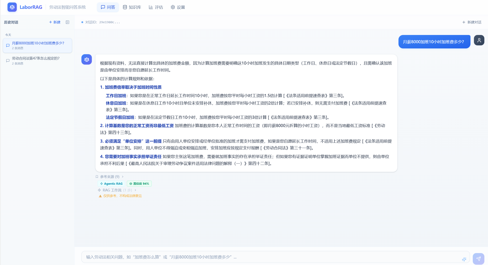
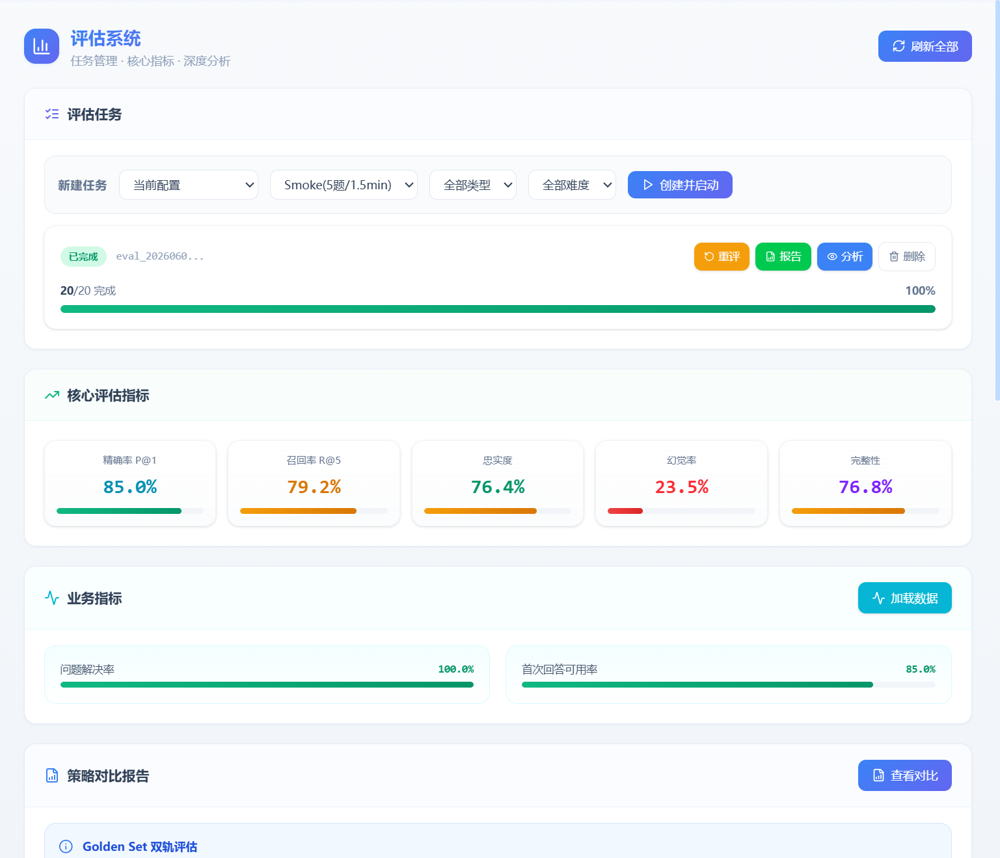
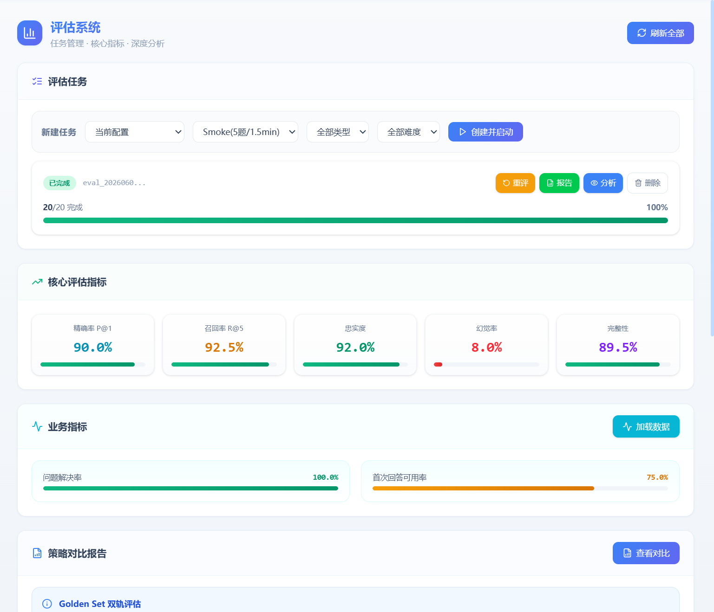
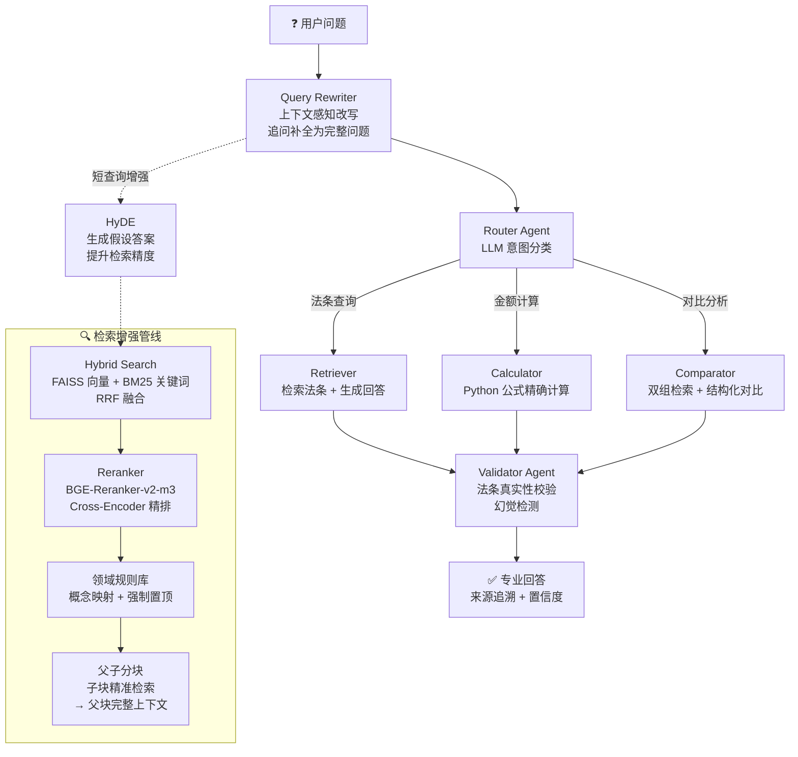

# LaborRAG · 劳动法智能问答系统

> 面向劳动法领域的智能问答系统——输入劳动法问题，自动检索法条、生成**带法条出处、可追溯**的回答，支持金额计算、法条对比、多轮追问。

- **检索精度 20% → 85%**（P@1）：定位口语与法条的语义鸿沟，用领域规则库优化并做单变量消融验证
- **333 个测试含 5 类 AST 结构守卫**：把分层依赖、惰性导入等约定变成会变红的规则
- **三元组评估 + 判分模型敏感性分析**：知道指标对判分模型与生成温度敏感，报数带口径
- **15 个 bug 复盘含 10 个静默失败**：能发现不报错、不崩溃的隐蔽缺陷

---

## 📸 系统截图

### 💬 智能问答

*问答页：来源追溯 + 工作流步骤可视化*

### 📊 三元组评估

*评估页：20 题 Golden Set 的 RAGAS / 检索 / 响应三维度指标*

### 📚 知识库管理

*知识库页：17 部劳动法文档、1243 个法条 chunk，支持上传与构建*

---

## 🚀 快速开始

### 环境要求
- Python 3.10+ · Node.js 18+ · Conda（推荐）

### 1. 后端配置

```bash
conda create -n RAG python=3.10
conda activate RAG
cd backend
pip install -r requirements.txt
cp .env.example .env          # 编辑 .env，填入百炼 API Key
```

### 2. 前端配置

```bash
cd frontend
npm install
```

### 3. 启动

```bash
# 终端 1 — 后端
conda activate RAG
python backend/run.py

# 终端 2 — 前端
python frontend/run.py
```

浏览器打开 `http://localhost:5173`

### 4. 运行测试

```bash
cd backend
pytest -v                     # 333 个用例，预期全绿（约 2 分钟）
```

> 本项目为个人求职作品，评估数据与 bug 复盘均为真实运行结果，非构造示例。

---

## 🏗️ 系统架构



> **概念注入**（概念映射 + 强制置顶）是**领域规则库的实现手段**：把口语化关键词直接定位到法条并置于首位，不参与重排竞争。

---

## 💬 系统功能详解

### 三种问题类型自动识别

| 问题类型 | 示例 | 处理方式 |
|---------|------|---------|
| **法条查询** | "加班工资怎么算？" "试用期最长多久？" | 检索法条 → LLM 基于资料生成回答 |
| **金额计算** | "月薪 8000 加班 10 小时加班费多少？" | 识别参数 → Python 公式精确计算 → 法条依据 |
| **对比分析** | "经济补偿金和赔偿金有什么区别？" | 双组检索 → 结构化对比表 |

### 关键能力

- **来源追溯**：每个回答附带参考法条来源、相关度分数
- **多轮对话**：支持追问，上下文感知查询改写自动补全
- **对话持久化**：前端 localStorage + 后端 JSON 双层持久化，重启不丢失
- **缺参引导**：计算类问题缺少参数时返回公式框架 + 法条依据
- **幻觉防护**：Validator 做**代码级**法条真实性校验（回答引用的法条必须存在于检索结果，否则删除引用它的整句）+ **14 条**高风险表述护栏，两者均**零 token**
- **拒答兜底**：提示词要求「完全无相关法条时须回答『根据现有资料无法回答』」，非劳动法问题因检索不到相关法条而触发该规则。⚠️ 代码级的检索充分性拒答分支受 `RETRIEVAL_VALIDATION` 控制，**默认关闭**
- **人性化回答**：**5 条**回答风格规则（事实底线 → 强制引用 → 结构清晰 → 通俗解释 → 禁止附加）

### 检索与生成技术栈

| 能力 | 技术 | 作用 |
|------|------|------|
| 混合检索 | FAISS 向量 + BM25(jieba) + RRF 融合 | 语义 + 关键词双路互补 |
| 重排序 | BGE-Reranker-v2-m3 Cross-Encoder | Top-K 精排，提升排序质量 |
| 领域规则库 | 概念映射 + 强制置顶 | 高置信度法条提升至首位（P@1 20%→85%） |
| 查询增强 | HyDE（短查询 ≤15 字触发）+ 上下文感知改写 | 生成假设答案提升检索精度 / 追问自动补全 |
| 自适应路由 | Adaptive RAG | 简单/中等难度走快速路径，省去意图路由与查询增强的多轮 LLM 调用；复杂问题走完整链路 |
| 事实校验 | 代码级规则校验（零 LLM） | 回答引用的法条必须存在于检索结果，否则删除引用它的整句 |
| 工作流编排 | 确定性骨架 + LLM 决策点 | 意图分发 + 专业处理 + 质量把关；流程固定可测，仅复杂问题进完整链路 |
| 降级兜底 | 异常时自动降级到 simple 模式 | 保证系统可用性 |

---

## 📚 覆盖法律（17 部）

| 法律文件 | 类别 |
|---------|------|
| 《劳动法》《劳动合同法》《劳动合同法实施条例》《劳动争议调解仲裁法》《社会保险法》 | 核心劳动法律 |
| 《工伤保险条例》《职工带薪年休假条例》《女职工劳动保护特别规定》《最低工资规定》《工资支付暂行规定》 | 行政法规 |
| 《失业保险条例》《职业病防治法》《住房公积金管理条例》 | 社会保障 |
| 《最高人民法院司法解释（一）（二）》 | 审判规则 |
| 《职工非因工伤残或因病丧失劳动能力程度鉴定标准》《法条适用前提速查表》 | 鉴定标准与速查 |

---

## 📊 评估体系

### 三元组构成

- **RAGAS 指标**：faithfulness / context_precision / context_recall
- **检索指标**：P@1 / P@3 / P@5 / R@5 / MRR / MAP（基于 relevant_articles 标注匹配）
- **响应指标**：ROUGE-L / BLEU / 幻觉率 / 完整性（LLM 评估）
- **双轨制**：Smoke Set（5 题快速验证）+ Full Set（20 题完整评估），Smoke ⊂ Full
- **分维度统计**：按 question_type + difficulty 分组
- **可观测面板**：检索质量 / 生成质量 / 业务指标三维度概览，Bad Case 快速定位
- **断点续评**：每题结果实时保存，崩溃/重启后可手动续评
- **任务管理**：创建 / 启动 / 继续 / 重评 / 停止 / 删除完整生命周期

### 核心指标（20 题 Full Set）

| 指标 | 得分 | 说明 | 测量时间 |
|------|------|------|---------|
| **精确率 P@1** | **85.0%** | 首位命中的法条准确率 | 2026-10-06 |
| **精确率 P@3** | **46.7%** | 前 3 条中相关法条的比例 | 2026-10-06 |
| **精确率 P@5** | **29.0%** | 前 5 条中相关法条的比例 | 2026-10-06 |
| **召回率 R@5** | **79.2%** | 前 5 条中相关法条的召回率 | 2026-10-06 |
| **MRR** | **91.7%** | 首个相关法条排名倒数的均值 | 2026-10-06 |
| **MAP** | **73.4%** | 平均精度均值 | 2026-10-06 |
| **忠实度 Faithfulness** | **76.5%** | 回答内容与检索资料的一致性 | 2026-10-06 ※ |
| **上下文精确率 Context Precision** | **70.6%** | 检索到的段落中真正相关的比例 | 2026-10-06 ※ |
| **上下文召回率 Context Recall** | **85.0%** | 参考答案要点被检索覆盖的比例 | 2026-10-06 ※ |
| **幻觉率 Hallucination** | **23.6%** | 回答中无依据内容的比例（= 1 − 忠实度） | 2026-10-06 ※ |
| **完整性 Completeness** | **76.8%** | 回答对参考答案的覆盖程度 | 2026-10-06 ※ |

> ※ 带此标记的四项由本次测量实际使用的判分模型 `deepseek-v4-pro-0813` 给出（「技术选型」表中的 `deepseek-v4.1-flash` 是推荐配置，两者不同）。

> 评估结果对判分模型和生成温度敏感；完整链路口径不可复现、零 LLM 基线可复现，口径说明与历史数据见 [`docs/evaluation-notes.md`](docs/evaluation-notes.md)。

---

## 🧠 技术选型与理由

| 层级 | 技术 | 用途 | 为什么选它 |
|------|------|------|-----------|
| LLM（生成） | 百炼 qwen3.8-max | 回答生成 | 官方文档点名适用于「法律、金融、设计」等专业任务；1 次/问题，质量优先 |
| LLM（辅助） | 百炼 qwen3.8-flash | 改写 / 路由 / HyDE / 多查询 / 充分性判断 | 调用量是生成槽的 5–6 倍，价格仅 max 的 1/15；支持关闭思考 |
| LLM（评判） | deepseek-v4.1-flash | RAGAS 三元组评判 | 换一个模型家族做评判，减少自偏好偏差 |
| Embedding | BAAI/bge-m3 | 文本向量化 | 中文语义 SOTA，本地 CPU 运行零 API 费用 |
| Reranker | BGE-Reranker-v2-m3 | Cross-Encoder 精排 | 与 BGE-M3 同系列一致性好，本地运行 |
| 向量库 | FAISS | 向量存储与检索 | 纯 C++ 零网络依赖，对比 Milvus/Weaviate 不需要 Docker |
| BM25 | jieba + rank_bm25 | 关键词检索 | jieba 中文分词成熟，与向量检索互补（语义 + 关键词） |
| 工作流编排 | LangGraph | 确定性骨架 + LLM 决策点（自适应路由） | StateGraph 天然支持条件分支，适合「路由 → 专业节点 → 校验」模式；流程固定可测、可追溯，仅关键决策点交 LLM |
| 工具调用 | Function Calling | 金额计算器（N / 2N / 加班费） | 由 LLM 决定调哪个工具、传什么参数，公式由 Python 执行，规避大模型算术误差 |
| 评估 | RAGAS + 自研指标 | 三元组评估 | RAGAS 覆盖忠实度/上下文精度/召回；自研指标补检索 + 响应维度 |
| 后端 | FastAPI + Uvicorn | API 服务 | 异步原生支持，Pydantic 集成，启动即校验配置 |
| 前端 | React + TypeScript + TailwindCSS | 用户界面 | 组件化 + 类型安全 + 原子化样式 |

### 设计取舍说明

- **为什么用领域规则库，而不是 GraphRAG**：法律条文之间的关系是法定的（如「第 46 条规定什么情形该补偿、第 47 条规定怎么算」），无需从语料自动抽取；人工维护的关系表零 token、可解释、可人工校验。它**不是**自动抽取实体关系 + 社区检测的知识图谱。
- **为什么是 Workflow 骨架 + LLM 决策点，而不是 Agentic RAG 循环**：流程与分支由代码固定，保证可追溯、可测试、可复现；仅意图判断这类关键决策交给 LLM。本项目属 **Advanced RAG**（Query 改写 / Multi-Query / 混合检索 / Rerank / 父子块）+ 自适应路由，单跳问答、单一数据源、命中率已 0.85，**未采用**「结果不好就换 Query 再查」的动态检索循环。

---

## 🤖 模型配置（三个 LLM 槽位）

本项目不是只用一个模型：三个槽位的用途与调用量差别很大，配错会把额度烧在错误的地方。

| 槽位 | 用途 | 每问题调用次数 | 选型侧重 |
|------|------|---------------|---------|
| `LLM_MODEL_NAME` | 生成主答案 | **1** | 质量（法律推理、指令遵循） |
| `EVAL_LLM_MODEL_NAME` | 改写 / 路由 / HyDE / 多查询 / 检索充分性 / 答案质量 | **5–6** | 速度 + 成本 + 结构化输出 |
| `RAGAS_MODEL_NAME` | RAGAS 三元组评判（留空则回落 EVAL） | 评估时大量 | 评判可靠性 + 成本 |

Embedding 与 Reranker 是**本地模型**（`BAAI/bge-m3` / `BAAI/bge-reranker-v2-m3`），不走任何 API。代码里每一处 LLM 调用都传 `extra_body={"enable_thinking": False}` —— 辅助槽要的是短结构化输出，思考模式会拖慢响应、产生隐藏 token 并可能污染输出。**辅助槽不要用强制开启思考、无法关闭的模型。**

具体型号与理由见上方「技术选型与理由」表。只想用两个模型时，`RAGAS_MODEL_NAME` 留空即可 —— `config.py` 会自动回落到 `EVAL_LLM_MODEL_NAME`。降本要点与具体模型实测对比见 [`docs/model-selection.md`](docs/model-selection.md)。

---

## 🔧 工程化实践

| 实践 | 实现 | 为什么值得 |
|------|------|---------|
| **单元测试** | pytest **333 个用例 / 30 个测试文件**，含 5 类结构守卫：AST 扫描强制分层依赖方向、禁用模块级重依赖、LLM 调用点无条件关思考、原生 DLL 加载顺序、HF 缓存目录设置时机 | `pyproject.toml` 配 pythonpath，`cd backend && pytest` 即跑，全绿约 2 分钟 |
| **离线检索基线** | `scripts/retrieval_baseline.py`：走生产检索节点的确定性路径，输出 P@1/P@3/P@5/R@5/MRR/MAP | 重构前后各跑一次比对数字；`--retriever` 做检索器消融、`--no-domain-boost` 做领域规则库消融 |
| **导入体检** | `scripts/smoke_import.py`：遍历 `app/**/*.py` 逐个 import，报告失败模块与慢导入 | 目录重构最容易断的是 import 链，静态体检更早发现 |
| **管线冒烟** | `scripts/graph_smoke.py`：把 `grader_llm`/`gen_llm` 换成确定性桩，离线跑通四条路径 | 零成本可重复，回答「管线通不通」；真实评估回答「答得对不对」 |
| **前端冒烟** | `scripts/frontend_smoke.py`：无头浏览器渲染四个路由，断言页面特征 + API 连通性 | `tsc -b` + `vite build` 只证明「能编译」，证明不了「浏览器真调通了后端」 |
| **鉴权冒烟** | `scripts/auth_smoke.py`：验公开端点可达、受保护端点 401、对凭证 200、401 带 `WWW-Authenticate` | `AUTH_SECRET` 留空时鉴权静默关闭，脚本明确报告而非假通过 |
| **访问鉴权** | `app/api/auth.py` 的 `verify_bearer` 依赖挂在 router 上 | 填值后除 `/health` 外全部端点要求 Bearer Token，新增端点自动受保护 |
| **导入惰性化** | torch / transformers / pymupdf4llm / langchain_text_splitters / langchain_community / langchain_openai / rag_engine 一律函数内导入；注解用 `TYPE_CHECKING` + 字符串 | `app.api.routes` 143.6s → **1.16s**；`app.main` **31.1s → 1.18s** |
| **包门面** | `app/retrieval/__init__.py` 暴露 `build_retriever` 系列，包外不依赖具体实现 | 构造逻辑原本在 `rag_engine` 里重复 3 次，改一处忘一处会让生产与评估用不同权重 |
| **结构化日志** | `logging.config.dictConfig`，格式 `时间 \| 级别 \| 模块 \| 消息` | 替代裸 print；uvicorn.access 过滤 `/evaluation/status` 轮询噪音 |
| **配置管理** | Pydantic BaseSettings，`.env` 驱动，启动即校验 | 12 种配置项自动类型转换，跨字段 fallback（EVAL→LLM, RAGAS→EVAL） |
| **全局异常处理** | `@app.exception_handler(Exception)` 统一 500/422 JSON 格式 | `request_id`（uuid）中间件串联请求全链路排障 |
| **安全钩子** | `githooks/pre-commit`：拦截 `.env` 提交 + 扫描 `sk-` 密钥串 | `.gitignore` 防线 1，钩子防线 2（兜底 `git add -f` 和代码里粘 key） |
| **日志编码** | stdout/stderr reconfigure 为 UTF-8 + errors=replace | Windows GBK 控制台写 emoji 不崩 |

测试过程中发现并修复 **15 个真实 bug，其中 10 个为静默失败**，精选 3 例见下节。

另做了两处消除重复的重构：检索器构造收敛到门面（原本在 `rag_engine` 里重复 3 次）、`file_lock` 下沉到 `utils`（恢复依赖方向）。全部经基线验证 Δ=0，详见 [`docs/refactor-notes.md`](docs/refactor-notes.md)。

---

## 🔍 工程严谨性：Bug 复盘精选

15 个 bug 里挑这 3 个，是因为它们分别代表三类**靠"跑通了"永远发现不了**的问题：结果不可复现（跨进程才暴露）、启动期副作用（被当成正常加载）、以及防护逻辑本身误伤正确内容。三者的共同点是都不报错。

### 检索结果不可复现：哈希随机盐

- **症状**：离线检索基线连跑两次，MAP 在 0.7294 / 0.7301 之间抖动，其余五项恰好稳定
- **根因**：`inject_related_articles` 直接迭代 `set()` 收集命中法条，字符串哈希带随机盐、迭代序随进程变化；后续按序截断，于是「顺序」变成了「选谁」
- **为什么难发现**：不报错；P@1/P@3/P@5/R@5/MRR 只看 top-5 恰好稳定，只有依赖完整排序的 MAP 露马脚；同进程内 set 迭代序固定，同进程跑两遍测不出来
- **修复与验证**：改为「列表 + 去重集合」保序去重，既确定又保住分数降序原意；用两个不同 `PYTHONHASHSEED` 的子进程比对输出

### `import app.main` 加载 2GB 模型，且离线直接崩

- **症状**：导入耗时 31s；代理异常时直接抛 `httpx.ProxyError`，服务连启动都到不了
- **根因**：模块级 `rag_engine = RAGEngine()` → `VectorStoreManager` → `get_embeddings()` 加载 BGE-M3（约 2GB），且构造时向 HF Hub 联网校验
- **为什么难发现**：`conftest.py` 把 `rag_engine` 换成替身，测试路径根本不走真实构造；`run.py` 走 uvicorn，启动慢被当成「模型加载正常」
- **修复与验证**：构造挪进 lifespan（uvicorn 在接收请求前执行，启动语义不变），类型注解改 `TYPE_CHECKING` + 字符串；`app.main` 31.1s → **1.18s**，并真起一次服务验证 `/health` 返回 `knowledge_base_ready: true`

### 幻觉护栏贪婪正则误删正确内容

- **症状**：上下文只支撑第 47 条时，期望删第二句，实际连第一句一起吞掉
- **根因**：删除正则 `《?[^》]*》?` 的贪婪 `[^》]*` 从更早位置开始匹配
- **为什么难发现**：只在护栏触发时发生（未触发直接返回原答案），损坏隐形；且测试盲区扫描发现 pytest 从未 import 过任何 agent 节点，`validate` 一行单测都没有
- **修复与验证**：按 `。；\n` 切句逐句检查法条引用，命中未支撑法条的整句丢弃；`test_validate_node.py` 11 例回归

> 其余 12 个 bug（含 7 个静默失败）的完整复盘见 [`docs/bug-postmortem.md`](docs/bug-postmortem.md)，覆盖法条切分正则漏字、中文数字解析散落 6 处、RAGAS 槽静默烧掉 98% 输出等。

---

## 📁 项目结构

```
LaborRAG/
├── backend/
│   ├── app/
│   │   ├── main.py                  # FastAPI 入口 + lifespan（引擎在此构造）+ 中间件
│   │   ├── core/                    # 最底层：配置与日志
│   │   │   ├── config.py            #   Pydantic BaseSettings + BASE_DIR/BACKEND_DIR 目录基准
│   │   │   └── logging.py           #   结构化日志配置（dictConfig）
│   │   ├── schemas/                 # API 数据模型
│   │   │   └── chat.py              #   请求 / 响应 DTO
│   │   ├── utils/                   # 零依赖原语（全项目共享的最底层）
│   │   │   ├── law_refs.py          #   法条编号正则 + 中文数字转换 + 法律名映射（唯一真相源）
│   │   │   ├── files.py             #   file_lock
│   │   │   └── text.py              #   文本处理助手
│   │   ├── knowledge/               # 知识库构建
│   │   │   ├── loader.py            #   文档加载（PDF/DOCX/TXT/MD）
│   │   │   ├── splitter.py          #   法条结构化切分（按「第X条」）
│   │   │   ├── embeddings.py        #   BGE-M3 Embedding
│   │   │   └── store.py             #   FAISS 向量库 + 父子分块
│   │   ├── retrieval/               # 检索层
│   │   │   ├── __init__.py          #   门面：build_retriever 收敛全部构造
│   │   │   ├── base.py              #   检索器接口
│   │   │   ├── vector.py            #   纯向量检索
│   │   │   ├── bm25.py              #   BM25 + jieba + 法律自定义词典
│   │   │   ├── hybrid.py            #   向量 + BM25 + RRF 融合
│   │   │   ├── reranked.py          #   叠加重排（CrossEncoder）
│   │   │   ├── query_enhance.py     #   口语化关键词 → 法言法语
│   │   │   └── domain_boost/        #   领域规则库（原 law_graph，757 行单文件拆为包）
│   │   │       ├── __init__.py      #     门面：再导出全部名字，调用点零改动
│   │   │       ├── relations.py     #     LAW_GRAPH 伴生法条关系表（纯数据）
│   │   │       ├── concepts.py      #     CONCEPT_ARTICLE_MAP 概念→法条表（纯数据）
│   │   │       ├── source_map.py    #     法律名 ↔ 文件名（真相源在 utils/law_refs）
│   │   │       └── lookup.py        #     查找与注入逻辑
│   │   ├── memory/
│   │   │   └── conversation.py      # 对话历史持久化（JSON）
│   │   ├── tools/
│   │   │   ├── labor_calculator.py  # 劳动法计算引擎（自含计算常量）
│   │   │   └── labor_tools.py       # 3 个 Function Calling 工具 + 执行器
│   │   ├── agent/                   # RAG 工作流（LangGraph 编排）
│   │   │   ├── graph.py             #   LangGraph 状态图
│   │   │   ├── state.py             #   AgentState
│   │   │   ├── prompts.py           #   全部 Prompt 模板
│   │   │   ├── guardrails.py        #   答案护栏
│   │   │   ├── constants.py         #   复杂度分类关键词
│   │   │   └── nodes/               #   8 个节点（rewrite/classify/router/retrieve/generate/…）
│   │   ├── services/
│   │   │   └── rag_engine.py        # RAG 引擎（检索 + 生成编排）
│   │   ├── evaluation/              # 三元组评估体系
│   │   │   ├── datasets/golden_set.py   # Golden Set 标注数据（20 题双轨制）
│   │   │   ├── metrics/retrieval.py     # 检索指标（P@1/P@3/P@5/R@5/MRR/MAP）
│   │   │   ├── metrics/response.py      # 响应指标（ROUGE-L/BLEU/幻觉率/完整性）
│   │   │   ├── runner.py            #   三阶段执行器
│   │   │   ├── persistent.py        #   断点续评 + 任务生命周期
│   │   │   ├── report.py            #   三维度对比报告
│   │   │   └── utils.py             #   评估公共工具
│   │   └── api/                     # HTTP 层（最上层）
│   │       ├── auth.py              #   Bearer 鉴权依赖
│   │       └── routes.py            #   API 路由
│   ├── run.py                       # 后端启动入口
│   ├── scripts/                     # 验证网 + 命令行工具
│   │   ├── smoke_import.py          #   全模块导入体检
│   │   ├── retrieval_baseline.py    #   离线确定性检索基线
│   │   ├── graph_smoke.py           #   Agent 图离线冒烟（桩 LLM，四条路径）
│   │   ├── frontend_smoke.py        #   前端冒烟（无头浏览器渲染四个路由）
│   │   ├── auth_smoke.py            #   鉴权冒烟
│   │   ├── retrieval_eval_full.py   #   完整链路检索评估
│   │   └── run_eval.py              #   命令行评估
│   ├── baselines/                   # 基线快照 JSON（重构前后比对）
│   ├── data/law_dict.txt            # jieba 法律自定义词典
│   ├── requirements.txt / pyproject.toml
│   └── tests/                       # 333 个测试
├── frontend/
│   ├── src/                         # React + TypeScript + TailwindCSS
│   │   ├── pages/                   # 四页面：问答/知识库/评估/设置
│   │   └── components/              # ChatWindow/ConversationSidebar/MessageBubble/InputBar
│   └── package.json
├── data/labor_laws/                 # 17 部劳动法文档
├── docs/
│   ├── agent_architecture.md        # 工作流架构说明
│   ├── evaluation-notes.md          # 评估口径与历史数据
│   ├── bug-postmortem.md            # 15 个 bug 完整复盘
│   ├── refactor-notes.md            # 架构收敛记录
│   ├── model-selection.md           # 模型选型笔记
│   └── screenshots/
├── githooks/pre-commit              # Git 安全钩子（拦截 .env 和 sk- 密钥）
└── README.md
```

---

## 📡 API 接口

| 方法 | 端点 | 说明 |
|------|------|------|
| POST | `/api/v1/chat` | 智能问答（支持多轮对话） |
| POST | `/api/v1/chat/stream` | 流式问答（SSE：节点进度 + token 流式） |
| GET | `/api/v1/knowledge-base/status` | 知识库状态 |
| POST | `/api/v1/knowledge-base/build` | 构建/重建知识库 |
| POST | `/api/v1/documents/upload` | 上传文档 |
| GET | `/api/v1/documents/list` | 文档列表 |
| DELETE | `/api/v1/documents/{filename}` | 删除文档 |
| POST | `/api/v1/evaluation/run` | 启动评估（后台异步） |
| GET | `/api/v1/evaluation/status` | 查询评估状态 |
| GET | `/api/v1/evaluation/report` | 获取评估报告 |
| POST/GET/DELETE | `/api/v1/evaluation/persistent/*` | 断点续评任务管理 |
| GET | `/health` | 健康检查（**免鉴权**，供容器/负载均衡探活） |

> **鉴权说明**：`AUTH_SECRET` 留空时所有端点开放，本地开发零配置即可跑通；一旦填值，除 `/health` 外的全部端点都要求 `Authorization: Bearer <AUTH_SECRET>`。前端在「设置 → 访问鉴权」页填入同一个值即可，令牌只存本机浏览器。

---

## 🔄 版本演进

每版解决上一版的核心问题，逐步提升系统能力：

| 版本 | 核心问题 | 新增能力 |
|------|---------|---------|
| **V1** | 从 0 到 1 搭建 RAG 基础 | 向量检索 + LCEL 链式生成 + 知识库管理 |
| **V2** | 纯向量检索精度不足 | 混合检索 + 重排序 + 法条切分 + 三元组评估 |
| **V3** | 无纠错能力，检索错误直接传给 LLM | HyDE 增强 + 多轮对话 + 检索充分性评估 |
| **V4** | 无法处理计算/对比类问题 | 意图路由 + 三条专业路径（检索/计算/对比）+ 上下文感知改写 + 人性化回答 |
| **V5** | P@1 仅 20%，概念注入被 reranker 淹没 | 领域规则库（概念映射 + 强制置顶）+ 评估体系完善 |
| **V6** | 金额计算靠正则抽参，口语化表达（"月薪八千"）易失配 | 计算器封装为 Function Calling 工具，LLM 自主选工具 + 传参，正则降级为兜底；SSE 流式问答 |

---

## ⚠️ 注意事项

- 向量库存储在 `RUNTIME_DATA_DIR`（默认项目内 `runtime_data/`）。FAISS 底层 C++ 不支持中文路径，若项目路径含中文需通过该变量指定纯英文路径
- 默认 `runtime_data/` 下没有 `vector_store/`，首次使用需先构建知识库（`POST /api/v1/knowledge-base/build`，或前端「知识库」页一键构建）
- **对外暴露服务前请设置 `AUTH_SECRET`**，否则所有接口无需凭证即可访问（启动日志会给出告警，`/health` 会返回 `auth_enabled: false`）
- BGE-M3 模型首次运行需下载约 2 GB，后续从本地缓存加载
- BGE-Reranker-v2-m3 首次运行需下载约 560 MB
- 国内环境建议设置 `HF_ENDPOINT=https://hf-mirror.com` 加速模型下载
- 评估并发度建议 2-4，过高可能触发 API 限流
- 本系统回答仅供参考，不构成法律意见

---

## 附录 A · 离线检索基线与受控消融

`scripts/retrieval_baseline.py` 直接调用生产检索节点 `retrieve_docs`（而非复刻简化逻辑），覆盖不依赖 LLM 的全部环节：复杂度分类 → 向量+BM25+RRF → 父子分块提升 → 领域规则库（伴生法条注入 + 概念置顶）→ 截断 → 兜底。

| 指标 | hybrid（生产路径） | reranked（评估路径） |
|------|------|------|
| precision@1 | 0.8500 | 0.8500 |
| precision@3 | 0.4667 | 0.5167 |
| precision@5 | 0.2900 | 0.3200 |
| recall@5 | 0.7750 | 0.8500 |
| mrr | 0.9250 | 0.9250 |
| map | 0.7384 | 0.7778 |

两条路径的 P@1 相同 —— 领域规则库已把正确法条锁定在第 1 位，重排器的价值体现在第 2–5 位（R@5 +0.075、MAP +0.039）。

### 受控消融：领域规则库贡献了多少

用 `--no-domain-boost` 在**同一套 20 题、同一份配置**上做单变量消融：

| 指标 | 开启领域规则库 | 关闭 | Δ |
|------|------|------|------|
| **precision@1** | **0.8500** | **0.2000** | **−0.6500** |
| precision@3 | 0.4667 | 0.1667 | −0.3000 |
| precision@5 | 0.2900 | 0.1100 | −0.1800 |
| **recall@5** | **0.7750** | **0.3500** | **−0.4250** |
| mrr | 0.9250 | 0.3226 | −0.6024 |
| map | 0.7384 | 0.2326 | −0.5058 |

**rank-1 命中变化：13 题因领域规则库而命中（关掉即 MISS），反向 0 题。**

| 类型 / 难度 | 题目 |
|---|---|
| retrieve / easy | 没签合同被辞了 |
| retrieve / easy | 被公司开除了有赔偿吗？ |
| retrieve / easy | 拖欠工资去哪投诉？ |
| retrieve / medium | 加班工资怎么算？ |
| retrieve / medium | 经济补偿金怎么计算？ |
| retrieve / medium | 什么情况可以认定为工伤？ |
| retrieve / medium | 女职工怀孕期间能安排夜班吗？ |
| retrieve / medium | 劳动争议申请仲裁的时效是多久？ |
| retrieve / hard | 下班路上被车撞了算工伤吗？ |
| retrieve / hard | 公司没交社保我可以随时辞职并要求补偿吗？ |
| calculate / hard | 月薪10000工作10年被违法辞退赔偿金多少？ |
| compare / medium | 经济补偿金和赔偿金有什么区别？ |
| compare / medium | 协商解除和公司单方辞退有什么区别？ |

劳动法条文用词高度重复，向量检索区分不出「该给补偿的情形」与「补偿怎么算」，领域规则库把「哪一条才对」显式写下来并强制置顶。

> **读法提示**：P@k 分母是 k 而非相关法条数，上限仅 1.0 / 0.633 / 0.380；P@5=0.29 不是「检索差」，看召回应读 recall@5 = 0.775。

基线可复现性已实测：同配置连跑两遍，六个指标 Δ 全为 0.0000，rank-1 逐题一致。口径说明与历史数据见 [`docs/evaluation-notes.md`](docs/evaluation-notes.md)。
